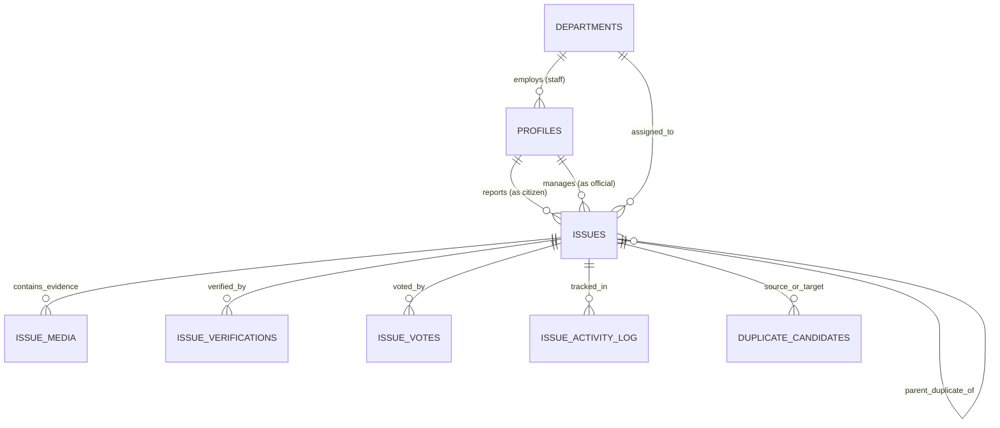

# CivicSync: Database Architecture & Relationship Design

> **Target Platform:** Supabase PostgreSQL with Row Level Security (RLS)  
> **Schema Design:** Production-Ready Relational Model  

---

## 1. Entity-Relationship Overview



---

## 2. Table Schemas & Data Dictionary

### 2.0 PostGIS Extension
CivicSync leverages PostGIS for high-accuracy ellipsoidal geographic distance calculations:
```sql
CREATE EXTENSION IF NOT EXISTS postgis;
```

### 2.1 `departments`
Stores municipal operational divisions responsible for executing physical resolutions.
```sql
CREATE TABLE public.departments (
    id UUID PRIMARY KEY DEFAULT gen_random_uuid(),
    name TEXT NOT NULL UNIQUE,                       -- e.g. 'Roads & Infrastructure'
    code TEXT NOT NULL UNIQUE,                       -- e.g. 'ROADS', 'SANITATION'
    contact_email TEXT NOT NULL,
    sla_hours_default INTEGER NOT NULL DEFAULT 72,   -- Default SLA in calendar hours (configurable)
    category_slas JSONB NOT NULL DEFAULT '{          -- Configurable category SLAs in calendar hours
        "water_leakage": 48,
        "drainage": 48,
        "garbage": 48,
        "street_lighting": 72,
        "pothole": 96,
        "other": 120
    }'::jsonb,
    created_at TIMESTAMPTZ NOT NULL DEFAULT now()
);
```

### 2.2 `profiles`
Extends `auth.users` with civic role metadata, phone, and optional department affiliation.
```sql
CREATE TYPE public.user_role AS ENUM ('citizen', 'official', 'department_staff', 'admin');

CREATE TABLE public.profiles (
    id UUID PRIMARY KEY REFERENCES auth.users(id) ON DELETE CASCADE,
    email TEXT NOT NULL,
    full_name TEXT NOT NULL,
    phone TEXT,
    role public.user_role NOT NULL DEFAULT 'citizen',
    department_id UUID REFERENCES public.departments(id) ON DELETE SET NULL,
    created_at TIMESTAMPTZ NOT NULL DEFAULT now(),
    updated_at TIMESTAMPTZ NOT NULL DEFAULT now()
);
```

### 2.3 `issues`
The central complaint entity capturing issue reports, geographic location, status, SLA deadline, and metrics.
```sql
CREATE TYPE public.issue_category AS ENUM (
    'pothole',
    'garbage',
    'water_leakage',
    'street_lighting',
    'drainage',
    'other'
);

CREATE TYPE public.issue_status AS ENUM (
    'reported',
    'verified',
    'under_review',
    'assigned',
    'in_progress',
    'resolved',
    'rejected',
    'duplicate'
);

CREATE TYPE public.issue_priority AS ENUM ('low', 'medium', 'high', 'critical');

CREATE TABLE public.issues (
    id UUID PRIMARY KEY DEFAULT gen_random_uuid(),
    ticket_number TEXT NOT NULL UNIQUE,               -- Formatted e.g. 'CIV-2026-0001'
    citizen_id UUID NOT NULL REFERENCES public.profiles(id) ON DELETE CASCADE,
    title TEXT NOT NULL,
    description TEXT NOT NULL,
    category public.issue_category NOT NULL,
    status public.issue_status NOT NULL DEFAULT 'reported',
    priority public.issue_priority NOT NULL DEFAULT 'medium',
    
    -- Geographic attributes with PostGIS geography point
    address_text TEXT NOT NULL,
    latitude DOUBLE PRECISION NOT NULL,
    longitude DOUBLE PRECISION NOT NULL,
    geom GEOGRAPHY(Point, 4326) GENERATED ALWAYS AS (
        ST_SetSRID(ST_MakePoint(longitude, latitude), 4326)::geography
    ) STORED,
    ward_number TEXT,
    
    -- Assignment & Operational SLA
    assigned_department_id UUID REFERENCES public.departments(id) ON DELETE SET NULL,
    assigned_official_id UUID REFERENCES public.profiles(id) ON DELETE SET NULL,
    deadline TIMESTAMPTZ,
    is_escalated BOOLEAN NOT NULL DEFAULT false,
    escalation_level INTEGER NOT NULL DEFAULT 0,
    escalated_at TIMESTAMPTZ,
    
    -- Deduplication link
    parent_issue_id UUID REFERENCES public.issues(id) ON DELETE SET NULL,
    
    -- Community metrics cache
    upvotes_count INTEGER NOT NULL DEFAULT 0,
    verifications_count INTEGER NOT NULL DEFAULT 0,
    
    -- Resolution details
    resolution_remarks TEXT,
    
    -- Timestamps
    created_at TIMESTAMPTZ NOT NULL DEFAULT now(),
    updated_at TIMESTAMPTZ NOT NULL DEFAULT now(),
    resolved_at TIMESTAMPTZ
);

-- PostGIS GiST Spatial Index and operational B-tree indexes
CREATE INDEX idx_issues_geom ON public.issues USING GIST (geom);
CREATE INDEX idx_issues_coordinates ON public.issues (latitude, longitude);
CREATE INDEX idx_issues_status ON public.issues (status);
CREATE INDEX idx_issues_category ON public.issues (category);
CREATE INDEX idx_issues_department ON public.issues (assigned_department_id);
CREATE INDEX idx_issues_deadline ON public.issues (deadline) WHERE status NOT IN ('resolved', 'rejected', 'duplicate');
```
```

### 2.4 `issue_media`
Stores photo evidence captured at submission and verification photographs uploaded upon resolution.
```sql
CREATE TYPE public.media_type AS ENUM ('image', 'document');

CREATE TABLE public.issue_media (
    id UUID PRIMARY KEY DEFAULT gen_random_uuid(),
    issue_id UUID NOT NULL REFERENCES public.issues(id) ON DELETE CASCADE,
    media_url TEXT NOT NULL,
    media_type public.media_type NOT NULL DEFAULT 'image',
    caption TEXT,
    is_resolution_proof BOOLEAN NOT NULL DEFAULT false,
    uploaded_by UUID NOT NULL REFERENCES public.profiles(id) ON DELETE SET NULL,
    created_at TIMESTAMPTZ NOT NULL DEFAULT now()
);

CREATE INDEX idx_issue_media_issue ON public.issue_media (issue_id);
```

### 2.5 `issue_verifications`
Crowd-sourced verification ledger. Citizens certify whether the issue is genuinely present or resolved.
```sql
CREATE TABLE public.issue_verifications (
    id UUID PRIMARY KEY DEFAULT gen_random_uuid(),
    issue_id UUID NOT NULL REFERENCES public.issues(id) ON DELETE CASCADE,
    user_id UUID NOT NULL REFERENCES public.profiles(id) ON DELETE CASCADE,
    is_verified BOOLEAN NOT NULL DEFAULT true,        -- true = confirmed exists, false = not found
    notes TEXT,
    created_at TIMESTAMPTZ NOT NULL DEFAULT now(),
    CONSTRAINT uq_user_issue_verification UNIQUE (issue_id, user_id)
);
```

### 2.6 `issue_votes`
Community prioritization ledger ensuring strict single-vote rules per user.
```sql
CREATE TABLE public.issue_votes (
    id UUID PRIMARY KEY DEFAULT gen_random_uuid(),
    issue_id UUID NOT NULL REFERENCES public.issues(id) ON DELETE CASCADE,
    user_id UUID NOT NULL REFERENCES public.profiles(id) ON DELETE CASCADE,
    created_at TIMESTAMPTZ NOT NULL DEFAULT now(),
    CONSTRAINT uq_user_issue_vote UNIQUE (issue_id, user_id)
);
```

### 2.7 `issue_activity_log`
Immutable audit trail tracking state transitions, reassignments, notes, and escalations.
```sql
CREATE TABLE public.issue_activity_log (
    id UUID PRIMARY KEY DEFAULT gen_random_uuid(),
    issue_id UUID NOT NULL REFERENCES public.issues(id) ON DELETE CASCADE,
    actor_id UUID REFERENCES public.profiles(id) ON DELETE SET NULL,
    action TEXT NOT NULL,                             -- e.g. 'CREATED', 'ASSIGNED', 'ESCALATED', 'RESOLVED'
    old_state JSONB,
    new_state JSONB,
    remarks TEXT,
    created_at TIMESTAMPTZ NOT NULL DEFAULT now()
);

CREATE INDEX idx_activity_log_issue ON public.issue_activity_log (issue_id);
```

### 2.8 `duplicate_candidates`
Pairs of issues identified by proximity or official review for deduplication triage.
```sql
CREATE TYPE public.duplicate_status AS ENUM ('suggested', 'confirmed_duplicate', 'dismissed');

CREATE TABLE public.duplicate_candidates (
    id UUID PRIMARY KEY DEFAULT gen_random_uuid(),
    source_issue_id UUID NOT NULL REFERENCES public.issues(id) ON DELETE CASCADE,
    target_issue_id UUID NOT NULL REFERENCES public.issues(id) ON DELETE CASCADE,
    distance_meters NUMERIC(8, 2) NOT NULL,
    similarity_score NUMERIC(4, 2) NOT NULL,          -- 0.00 to 1.00
    status public.duplicate_status NOT NULL DEFAULT 'suggested',
    reviewed_by UUID REFERENCES public.profiles(id) ON DELETE SET NULL,
    reviewed_at TIMESTAMPTZ,
    created_at TIMESTAMPTZ NOT NULL DEFAULT now(),
    CONSTRAINT uq_duplicate_pair UNIQUE (source_issue_id, target_issue_id)
);
```

---

## 3. Core Database Functions, Procedures & Triggers

### 3.1 PostGIS Proximity Duplicate Detection Engine
Calculates spatial proximity using PostGIS ellipsoidal calculations (`ST_DWithin` on the GiST index) within a 75-metre radius for active issues in the same category:
```sql
CREATE OR REPLACE FUNCTION public.detect_duplicate_candidates(
    p_issue_id UUID,
    p_latitude DOUBLE PRECISION,
    p_longitude DOUBLE PRECISION,
    p_category public.issue_category,
    p_radius_meters DOUBLE PRECISION DEFAULT 75.0
)
RETURNS TABLE (
    candidate_id UUID,
    distance_meters NUMERIC
) LANGUAGE plpgsql SECURITY DEFINER AS $$
BEGIN
    RETURN QUERY
    SELECT 
        i.id,
        ROUND(ST_Distance(i.geom, ST_SetSRID(ST_MakePoint(p_longitude, p_latitude), 4326)::geography)::numeric, 2) AS distance_meters
    FROM public.issues i
    WHERE i.id <> p_issue_id
      AND i.category = p_category
      AND i.status IN ('reported', 'verified', 'under_review', 'assigned', 'in_progress')
      AND ST_DWithin(i.geom, ST_SetSRID(ST_MakePoint(p_longitude, p_latitude), 4326)::geography, p_radius_meters)
    ORDER BY distance_meters ASC;
END;
$$;
```

### 3.2 Non-Silent Priority Escalation Trigger
Monitors community engagement. When an issue reaches $\ge 5$ votes or $\ge 3$ community verifications, priority is elevated to `high` and an explicit audit record is written to `issue_activity_log` documenting the trigger reason:
```sql
CREATE OR REPLACE FUNCTION public.check_priority_escalation()
RETURNS TRIGGER LANGUAGE plpgsql SECURITY DEFINER AS $$
DECLARE
    v_new_priority public.issue_priority;
    v_reason TEXT;
BEGIN
    IF (NEW.upvotes_count >= 5 OR NEW.verifications_count >= 3) AND NEW.priority IN ('low', 'medium') THEN
        v_new_priority := 'high';
        v_reason := format('Priority automatically elevated to high due to community engagement threshold: %s upvotes, %s verifications.', NEW.upvotes_count, NEW.verifications_count);
        
        UPDATE public.issues 
        SET priority = v_new_priority, updated_at = now() 
        WHERE id = NEW.id;

        INSERT INTO public.issue_activity_log (issue_id, actor_id, action, remarks, old_state, new_state)
        VALUES (
            NEW.id,
            NULL,
            'PRIORITY_ESCALATED',
            v_reason,
            jsonb_build_object('priority', OLD.priority),
            jsonb_build_object('priority', v_new_priority)
        );
    END IF;
    RETURN NEW;
END;
$$;

CREATE TRIGGER trg_issue_priority_check
AFTER UPDATE OF upvotes_count, verifications_count ON public.issues
FOR EACH ROW
EXECUTE FUNCTION public.check_priority_escalation();
```

### 3.3 Server-Side Scheduled SLA Overdue Escalator (`pg_cron`)
A scheduled server-side routine (executing every 15 minutes via Supabase `pg_cron` or scheduled Edge Function). **Never uses frontend polling or browser timers.**
```sql
CREATE OR REPLACE FUNCTION public.check_and_escalate_overdue_issues()
RETURNS INTEGER LANGUAGE plpgsql SECURITY DEFINER AS $$
DECLARE
    v_escalated_count INTEGER := 0;
    r RECORD;
BEGIN
    FOR r IN 
        SELECT id, priority, assigned_department_id, deadline 
        FROM public.issues
        WHERE status NOT IN ('resolved', 'rejected', 'duplicate')
          AND deadline IS NOT NULL
          AND deadline < now()
          AND is_escalated = false
    LOOP
        UPDATE public.issues
        SET is_escalated = true,
            escalation_level = 1,
            escalated_at = now(),
            updated_at = now()
        WHERE id = r.id;

        INSERT INTO public.issue_activity_log (issue_id, actor_id, action, remarks, old_state, new_state)
        VALUES (
            r.id,
            NULL,
            'SLA_OVERDUE_ESCALATION',
            format('Ticket exceeded SLA deadline of %s. Escalated to level 1 for supervisor attention.', r.deadline),
            jsonb_build_object('is_escalated', false),
            jsonb_build_object('is_escalated', true, 'escalation_level', 1)
        );

        v_escalated_count := v_escalated_count + 1;
    END LOOP;

    RETURN v_escalated_count;
END;
$$;

-- Cron Schedule (Server-Side)
-- SELECT cron.schedule('check-sla-escalations', '*/15 * * * *', 'SELECT public.check_and_escalate_overdue_issues()');
```

### 3.4 Resolution Mandate Validation Trigger
Enforces that marking an issue as `RESOLVED` strictly requires resolution remarks and at least one post-resolution verification photograph uploaded to storage:
```sql
CREATE OR REPLACE FUNCTION public.validate_resolution_criteria()
RETURNS TRIGGER LANGUAGE plpgsql AS $$
DECLARE
    v_has_proof BOOLEAN;
BEGIN
    IF NEW.status = 'resolved' AND (OLD.status IS DISTINCT FROM 'resolved') THEN
        -- Check mandatory remarks
        IF NEW.resolution_remarks IS NULL OR trim(NEW.resolution_remarks) = '' THEN
            RAISE EXCEPTION 'Cannot resolve issue: Resolution remarks are mandatory.';
        END IF;

        -- Check mandatory resolution proof photo in issue_media
        SELECT EXISTS (
            SELECT 1 FROM public.issue_media 
            WHERE issue_id = NEW.id AND is_resolution_proof = true
        ) INTO v_has_proof;

        IF NOT v_has_proof THEN
            RAISE EXCEPTION 'Cannot resolve issue: At least one post-resolution verification photograph is required.';
        END IF;

        NEW.resolved_at := now();
    END IF;
    RETURN NEW;
END;
$$;

CREATE TRIGGER trg_validate_issue_resolution
BEFORE UPDATE OF status ON public.issues
FOR EACH ROW
EXECUTE FUNCTION public.validate_resolution_criteria();
```

---

## 4. Row Level Security (RLS) Policy Blueprint

Every table has `ALTER TABLE ... ENABLE ROW LEVEL SECURITY;`.

| Table | Operation | Target Role | Security Rule Definition |
| :--- | :--- | :--- | :--- |
| **`departments`** | `SELECT` | `public`, `authenticated` | Open to all users. |
| | `INSERT/UPDATE`| `official`, `admin` | Restricted to administrators. |
| **`profiles`** | `SELECT` | `authenticated` | Users can read all public profiles; full details protected. |
| | `UPDATE` | `authenticated` | Users can only update their own profile (`auth.uid() = id`). |
| **`issues`** | `SELECT` | `public` / `anon` | Accessible for public transparency (anonymized view excluding citizen contact). |
| | `INSERT` | `citizen` | Allowed if `auth.uid() = citizen_id`. |
| | `UPDATE` | `official`, `department_staff` | Allowed for assigned department staff or triage officials. |
| **`issue_media`** | `SELECT` | `public`, `authenticated` | Open read access for issue evidence. |
| | `INSERT` | `authenticated` | Citizens can upload initial evidence (`is_resolution_proof = false`) to their own issues (`citizen_id = auth.uid()`). Officials and staff can upload media and resolution proofs (`is_resolution_proof = true`). |
| **`issue_verifications`** | `SELECT` | `public`, `authenticated` | Open read access. |
| | `INSERT` | `authenticated` | Single verification per issue (`auth.uid() = user_id`). Self-verification and voting on closed issues disallowed. Immutable (no `UPDATE` or `DELETE`). |
| **`issue_votes`** | `SELECT` | `public`, `authenticated` | Open read access. |
| | `INSERT/DELETE`| `authenticated` | User can only vote/unvote their own record (`auth.uid() = user_id`). Voting on closed issues disallowed. |
| **`issue_activity_log`** | `SELECT` | `authenticated` | Viewable by all authenticated users for transparency. |
| | `INSERT` | `authenticated` | Inserted via application logic or database triggers. Immutable (no `UPDATE` or `DELETE`). |
| **`duplicate_candidates`**| `SELECT/UPDATE`| `official`, `admin` | Restricted to officials during deduplication triage. |

---

## 5. Supabase Storage Buckets

1. **`issue-evidence` (Public Read):**
   - Upload policy: Authenticated citizens can upload images up to 5MB (`image/jpeg`, `image/png`, `image/webp`) under their isolated user path `${auth.uid()}/${filename}`.
   - Read policy: Publicly accessible via CDN URL.
2. **`resolution-proofs` (Public Read):**
   - Upload policy: Authenticated officials and department staff only (`official`, `department_staff`), isolated under `${auth.uid()}/${filename}`.
   - Read policy: Publicly accessible via CDN URL.

