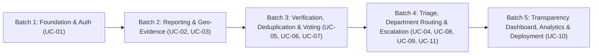

# CivicSync: Five-Batch Implementation Roadmap

> **Framework:** Phased Modular Engineering  
> **Use Case Traceability:** 100% of the 11 Documented Use Cases Covered  

---

## Batch Overview & Mapping Matrix

---

## Batch 1: Foundation, Editorial Design System & Authentication Layer
*Focus: Environment initialization, design token system, Supabase client, and secure RBAC.*

- **Use Cases Covered:**
  - **UC-01: Authenticate User** (Citizen / Official login, registration, role identification, session handling).
- **Core Engineering Deliverables:**
  1. Vite + React + TypeScript clean workspace setup.
  2. Tailwind CSS configuration implementing the warm neutral palette (`stone-50` / `stone-200`) and Deep Forest Green accents (`#1B4332`, `#2D6A4F`).
  3. Installation of essential shadcn/ui components (`Button`, `Card`, `Dialog`, `Input`, `Select`, `Badge`, `Tabs`, `Toast`).
  4. Supabase authentication integration (`useAuth` hook, session listener, profile synchronization trigger). Demo accounts (`citizen@civicsync.org`, `official@civicsync.org`, `roads.dept@civicsync.org`) use standard email/password authentication and strictly obey role-based permissions without bypassing RLS.
  5. Role-based route guard (`ProtectedRoute`) enforcing access for `public`, `citizen` (which includes community member permissions), `official`, and `department_staff`.
- **Exit Criteria:**
  - User can register as a citizen or log in as an official.
  - Authenticated session correctly extracts role and renders the appropriate navigation shell.

---

## Batch 2: Issue Reporting Engine, Geolocation & Photographic Evidence
*Focus: Citizen reporting experience, Leaflet map integration, and media pipeline.*

- **Use Cases Covered:**
  - **UC-02: Report Civic Issue** (Complaint submission, validation, ticket assignment).
  - **UC-03: Upload Location and Evidence** (Leaflet pin placement, reverse geocode, image upload).
- **Core Engineering Deliverables:**
  1. Leaflet + OpenStreetMap interactive location picker component with GPS auto-detection and address reverse-geocoding fallback.
  2. Multi-step issue submission modal / page with Zod schema validation (category, description, location, ward).
  3. Image capture and upload pipeline targeting Supabase Storage bucket (`issue-evidence`) with client-side file compression and preview.
  4. Automatic sequential ticket generator (`CIV-YYYY-XXXX`).
  5. Citizen personal dashboard ("My Reported Issues") showing real-time status tracker for submitted complaints.
- **Exit Criteria:**
  - Citizen can place a pin on a map, attach a photo, fill out details, and submit a complaint.
  - Issue record and media metadata are persisted in Supabase with generated ticket number.

---

## Batch 3: Community Verification, Proximity Deduplication & Prioritization
*Focus: Community consensus, anti-spam mechanisms, and spatial duplicate triage.*

- **Use Cases Covered:**
  - **UC-05: Verify Civic Issue** (Citizen verification assessment, counter increments).
  - **UC-06: Detect Duplicate Complaint** (PostGIS spatial proximity calculation, duplicate pairing, merge flow).
  - **UC-07: Vote and Prioritize Issue** (Single-vote upvoting mechanism, priority score update).
- **Core Engineering Deliverables:**
  1. Distinct community features:
     - **Voting (Prioritization):** Upvote toggle button enforcing 1 vote per citizen per issue (optimistic UI update).
     - **Verification (Ground-truth audit):** Independent community verification widget allowing 1 verification per citizen per issue (`Still Exists`, `Resolved`, `Not Found`).
  2. PostGIS geographic distance engine evaluating a configurable **75-metre radius** using `ST_DWithin` on GiST-indexed `geography(Point, 4326)` to detect active duplicate candidates in the same category.
  3. Non-silent priority elevation: When an issue reaches $\ge 5$ upvotes or $\ge 3$ verifications, priority is elevated to `high` and an explicit audit record is written to `issue_activity_log` documenting the trigger condition.
  4. Official duplicate comparison modal displaying side-by-side photo evidence, location, and timestamps for merge or dismissal.
- **Exit Criteria:**
  - Community members can vote and verify nearby complaints independently once per user.
  - Submitting an issue within 75m of an active issue flags it for duplicate review without dropping the complaint.
  - Priority auto-escalation creates an explicit audit log entry.

---

## Batch 4: Official Triage Console, Department Routing & SLA Escalation
*Focus: Administrative operational control, department delegation, and resolution lifecycle.*

- **Use Cases Covered:**
  - **UC-04: Manage Complaint** (Official review, filtering, status transitions).
  - **UC-08: Assign Complaint to Department** (Department routing, SLA assignment).
  - **UC-09: Track Deadline and Escalate Complaint** (Overdue SLA tracking, escalation trigger).
  - **UC-11: Update Complaint Status and Resolve Issue** (Field staff progress notes, resolution proof upload).
- **Core Engineering Deliverables:**
  1. Official triage workspace with split-pane inspection, multi-attribute filtering (ward, priority, category, status).
  2. Department routing modal with configurable SLA deadlines defined in calendar hours per category (e.g., Water: 48h, Sanitation: 48h, Lighting: 72h, Roads: 96h, Other: 120h).
  3. Scheduled server-side overdue escalation job (Supabase `pg_cron` / Edge Function running every 15 minutes), **not client-side timers or frontend polling**, that automatically flags `is_escalated = true`, sets `escalation_level = 1`, and logs the event in `issue_activity_log`.
  4. Municipal department resolution modal requiring **mandatory resolution remarks** and **at least one post-resolution verification photograph** uploaded to `resolution-proofs`.
  5. Comprehensive audit trail generation (`issue_activity_log`) on every status transition.
- **Exit Criteria:**
  - Official can assign an issue to a department with a configurable calendar-hour deadline.
  - Server-side scheduled job reliably detects overdue issues and flags them.
  - Department staff cannot mark an issue resolved without providing resolution remarks and photographic evidence.

---

## Batch 5: Public Transparency Dashboard, Citywide Analytics & Deployment
*Focus: Public accountability, Recharts data visualization, automated tests, and Vercel launch.*

- **Use Cases Covered:**
  - **UC-10: View Transparency Dashboard** (Public metrics, departmental performance, resolution rates).
  - End-to-end integration and verification of all 11 use cases.
- **Core Engineering Deliverables:**
  1. Public-facing `/transparency` portal with zero authentication barrier, featuring strict data sanitization (all citizen PII redacted via RLS).
  2. Recharts interactive metric visualizations:
     - Municipal resolution rate (%) and average turnaround time in calendar hours/days.
     - Department-by-department performance comparison and SLA compliance bar charts.
     - Category breakdown (donut chart) and temporal trend lines.
  3. Public citywide interactive map showing anonymized issue markers and resolution status.
  4. Automated test suite using Vitest:
     - Form validation and Zod schema tests.
     - PostGIS distance calculation and duplicate detection query tests.
     - Non-silent priority escalation logging tests.
     - Server-side SLA overdue math and escalation state tests.
     - Role guard and RLS permission boundary tests.
  5. Vercel deployment configuration (`vercel.json`), production asset optimization, and accessibility audit.
- **Exit Criteria:**
  - Public dashboard renders live metrics from Supabase without exposing PII.
  - Test suite passes with 100% green status on core operational workflows.
  - Application builds cleanly and is ready for Vercel deployment.
- **Exit Criteria:**
  - Public dashboard renders live metrics from Supabase without exposing PII.
  - Test suite passes with 100% green status on core operational workflows.
  - Application builds cleanly and is ready for Vercel deployment.

